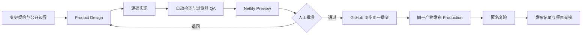

# 石听 NeoLoop｜网站生产与发布工作流

- 状态：项目网站唯一运行手册
- 正式地址：<https://shiting-neoloop-demo.netlify.app>
- 公开仓库：<https://github.com/b46ngpvmbt-create/shiting-neoloop>
- 主托管：Netlify
- 标准构建：`npm run build:netlify` → `netlify-dist/`

## 1. 目的与适用范围

本流程覆盖石听 NeoLoop 网站的内容边界、Product Design、React/Vinext 开发、自动检查、浏览器验收、Netlify 预览与正式发布、GitHub 同步、回滚和交接。

网站是公开的合成交互原型，不是赛事飞书正式作品，不表示已经接入新石器生产数据、内部系统或真实业务流程。

`docs/` 下的手写静态页是旧版 GitHub Pages 降级页，不含当前完整六步交互和团队页，不能当作 Netlify 主站的等价镜像。ChatGPT Sites 曾成功部署，但匿名访问持续返回 Cloudflare 403，因此不作为正式入口。

## 2. 不可变基线

- 队名：石听未来。
- 产品名：石听 NeoLoop。
- 一句话价值：让每条反馈都找到一辆车、一个任务、一个责任人和一次改进。
- 不重复查车、发车、开门、充电调度和经营问答等既有能力。
- 不控制车辆，不自动认定事故责任、赔偿、恢复时间或最终技术根因。
- AI 只给建议；关键分级、责任路由、回复、结案、根因和知识发布保留企业人工确认。
- 参赛成员负责项目设计与制作，不是演示中企业闭环的执行人。

### 2.1 四类内容边界

| 类型 | 准入条件 | 页面措辞 | 禁止事项 |
| --- | --- | --- | --- |
| 公开事实 | 有可追溯的公开来源 | “公开资料显示……” | 推断企业未公开的内部状态 |
| 待企业验证 | 尚无企业证据 | “待企业确认/验证” | 写成已确定的字段、SLA、流程或责任 |
| 方案设计 | 团队拟建的功能和流程 | “候选、草案、原型、建议” | 写成已上线、已接入或已执行 |
| 合成实验 | `DEMO-*` 或明确虚构的数据 | “合成、模拟、示例值” | 写成真实客户、车辆、事故或经营成效 |

### 2.2 个人信息公开白名单

当前允许：

- 刘肖蔚然、闫紫豪；
- 青岛农业大学；
- 风景园林（虚拟现实技术设计）；
- 队长、队员；
- 生成的姓氏头像。

当前不公开：

- 项目贡献；
- GitHub、作品集、邮箱、电话或其他联系方式；
- 报名表、身份证明、授权文件和赛事后台截图。

新增、替换或扩大任何个人字段的展示范围，都需要信息本人再次明确确认。当前文件没有联系方式，不代表公开 Git 历史没有联系方式。

## 3. 代码与产物权责图

| 内容 | 唯一或主要来源 | 说明 |
| --- | --- | --- |
| 主交互、业务文案、六步演示 | `app/page.tsx` | 当前五个视图均为根页面内的 React 状态 |
| 视觉系统与响应式 | `app/globals.css` | 桌面与移动布局 |
| SEO、OG、Twitter 元数据 | `app/layout.tsx` | 生产域名由请求头生成 |
| 头像与分享图 | `public/` | 发布前同时做视觉与隐私检查 |
| Netlify 导出 | `scripts/export-netlify-static.mjs` | 复制客户端资源并 SSR 根路由 `/` |
| 公网自动检查 | `scripts/verify-deploy.mjs` | 检查 HTML、固定边界文本和同源资源 |
| 构建期断言 | `tests/rendered-html.test.mjs` | 品牌、成员、合成数据与角色边界 |
| 视觉与人工交互证据 | `qa/`、`design-qa.md` | 证据，不替代可重复检查 |
| 旧版降级页 | `docs/index.html`、`docs/app.js` | 不是当前主站同版产物 |
| 生成目录 | `dist/`、`netlify-dist/` | 禁止手工编辑，未提交 Git |

当前 `app/page.tsx`、`data/demo-cases.json` 和 `docs/app.js` 存在三套案件表达，且内容已漂移。新增主站内容以 `app/page.tsx` 为准；长期应迁移到一个结构化数据源，完成前不得把三者描述为同步数据。

## 4. 端到端流程



### 阶段 A｜写变更契约

每次修改先记录：

```text
目标和受众：
受影响页面/状态：
新增或改变的公开主张：
数据来源和四类边界：
个人信息影响：
交互与部署影响：
自动检查：
人工检查：
回滚目标：
```

旧简报、旧截图和旧静态页只能作为历史输入，不能覆盖更新日期更晚的项目决定或本人授权。

### 阶段 B｜Product Design

在写代码前确认：

1. 信息架构：产品概览、合成演示、反馈案件、问题簇、参赛团队。
2. 主故事：以 `DEMO-C-002` 展示并案、关联、派单、处置、验证、改进。
3. 角色：企业客服专员、企业运营协调员、企业值班经理、企业车辆运维负责人、企业授权审批人、企业产品/质量负责人。
4. 人工关口：风险与责任确认、回复与结案审批；页面跳步只用于原型演示，不代表真实权限强制。
5. 视觉方向：以 `qa/reference-selected.png` 为参考，保持海军蓝、钴蓝、薄荷绿、暖白和平面编辑感。
6. 响应式：桌面基准 `1440 × 1024`，移动基准 `390 × 844`。
7. 文案边界：所有业务数据标注合成；企业角色、SLA、根因和成效继续标注待确认或示例。

设计变化后更新 `design-qa.md`，截图名至少包含日期、提交 SHA、视口和页面/状态。

### 阶段 C｜源码实现

- 只修改源文件，不编辑 `dist/` 或 `netlify-dist/`。
- 新增真实路由、服务端请求或外部 API 前，先决定是否仍适合根路由静态导出。
- 头像、OG 图、QA 截图也属于公开内容，不能只检查文本。
- 保留语义化结构、替代文本、可见焦点、键盘可操作性和无横向溢出。
- 本地点击只改变合成状态，不得新增真实工单、消息发送、数据上传或车辆指令。

### 阶段 D｜本地发布门槛

标准运行时由 `.nvmrc` 和 `netlify.toml` 固定为 Node `22.13.0`。

```bash
node --version
npm --version
npm ci
npm run check:release
npm audit --omit=dev
npm audit
```

`npm run check:release` 依次执行 lint、SSR/边界测试和最终 Netlify 导出。现有脚本会重复构建，但 `build:netlify` 必须最后执行，保证 `netlify-dist/` 对应最新源码。

审计结果需要记录和分级，不得把“静态站没有 Node 服务端运行时”写成“依赖无风险”。不要自动执行破坏性依赖升级。

形成候选版本：

```bash
git diff --check
git status --short --branch
git add <明确文件>
git commit -m "<说明>"
git status --short --branch
git rev-parse HEAD
shasum -a 256 netlify-dist/index.html
```

最终构建后如果任何受 Git 跟踪的源文件发生变化，当前 `netlify-dist/` 立即作废，必须重新执行完整门槛。

### 阶段 E｜浏览器 QA

| 检查面 | 必查内容 |
| --- | --- |
| 产品概览 | 固定价值、证据边界、软件入口、团队摘要 |
| 六步演示 | 六步完整走通、重置、人工确认弹窗、退回/继续检查路径 |
| 反馈案件 | 风险筛选、案件切换、`DEMO-C-002` 入口 |
| 问题簇 | 问题簇切换、改进演示入口、示例值声明 |
| 团队页 | 两名成员白名单字段、参赛者与企业角色分离 |
| 桌面/移动 | `1440 × 1024`、`390 × 844`、无横向溢出 |
| 可访问性 | 键盘顺序、焦点、按钮名称、弹窗焦点/Esc、图片替代文本、对比度 |
| 技术状态 | 控制台无应用错误、同源资源无失败、刷新后本地状态重置 |
| 分享信息 | 标题、描述、OG/Twitter 图和生产域名 |

当前仓库没有自动浏览器 E2E；上述交互检查仍是正式人工门槛，不能因为 SSR 文本测试通过而省略。

### 阶段 F｜Netlify 预览

先确认登录和站点链接：

```bash
npx netlify status
```

只允许上传刚刚由当前干净提交生成并验收的目录：

```bash
npx netlify deploy --dir netlify-dist --no-build --json
npm run verify:deploy -- "https://<preview-host>/"
```

`--no-build` 的目的，是让 Netlify 接收已经通过本地门槛的同一产物；它不能用来绕过失败构建或发布未知旧目录。本机若出现 npm 缓存权限问题，可为单次命令使用 `npm_config_cache=/tmp/neoloop-npm-cache`，不要修改全局缓存权限来绕过问题。

预览必须通过：匿名 HTTP 200、固定边界文本、9 类当前同源资源、桌面/移动关键流程、控制台和隐私白名单。记录 preview URL、deploy ID、日志 URL、HTML SHA-256 和人工批准。

### 阶段 G｜同步 GitHub

预览通过后、正式发布前，把同一候选提交同步到远端：

```bash
git fetch origin
git rev-list --left-right --count origin/main...HEAD
git push --progress origin main
git rev-parse HEAD origin/main
```

只有远端没有未合并提交，且本地/远端 SHA 一致，才进入正式发布。推送需要明确授权；公共仓库回滚优先使用 `git revert`，不未经授权重写历史或强推。

若 HTTPS 推送长期无进度，先核验 GitHub CLI/API，再仅对该次命令使用：

```bash
git -c http.version=HTTP/1.1 push --progress origin main
```

不要把 HTTP/1.1 写入全局 Git 配置，也不要盲目改用未经验证的 SSH。

### 阶段 H｜正式发布与复验

不重新构建，晋升预览中已经验收的同一目录：

```bash
npx netlify deploy --dir netlify-dist --no-build --prod --json
npm run verify:deploy -- "https://shiting-neoloop-demo.netlify.app/"
```

正式发布后再次检查：

- 固定地址匿名返回 200；
- 本地、预览、正式 HTML 哈希一致；
- CSS、JavaScript、头像和 OG 图均返回成功；
- 无痕浏览器与常用手机网络可打开；
- 核心交互和控制台无错误；
- 成员白名单、合成声明和角色边界未漂移。

### 阶段 I｜发布记录与交接

复制 `docs/RELEASE_RECORD_TEMPLATE.md` 到 `docs/releases/YYYY-MM-DD_<short-sha>.md`，填写提交 SHA、运行时、CLI 版本、产物哈希、preview/production deploy ID、人工批准、已知风险和回滚点。

项目记忆只记录任务、完成项、文件、决定、问题、下一步和可复用知识；不写令牌、账号凭据、完整日志、客户数据或整段聊天。

## 5. 回滚

1. Netlify 先恢复到上一条已验收部署，最快恢复固定地址。
2. 源码使用 `git revert` 形成可审计修复，重新走完整预览与正式发布流程。
3. 不直接回滚到包含已知隐私问题的旧提交；公开 Git 历史清理必须作为独立任务获得明确授权。
4. 回滚后复查正式 URL、全部资源、个人信息、合成声明、角色边界和六步交互。

## 6. 故障恢复表

| 故障 | 处理 | 禁止事项 |
| --- | --- | --- |
| Node 26 下 CLI 重复构建失败 | 使用 Node 22.13.0 fresh build，再上传已验收目录 | 发布旧 `netlify-dist/` |
| `netlify-dist/` 不存在 | 重新执行 `npm run check:release` | 改指向缺少首页的 `dist/client` |
| 首页空白或资源 404 | 检查导出 HTML 和资源，重建 preview | 用 catch-all 重写掩盖缺失资源 |
| Preview 失败 | 停在 Preview，修复后重走门槛 | 直接 `--prod` |
| Sites 返回 403 | 继续以 Netlify 为主演示 | 把 Sites 当唯一入口 |
| Netlify 临时故障 | 临时说明并使用功能缩减的 `docs/` 降级页 | 宣称降级页与主站等价 |
| Git 推送卡顿 | 核验 OAuth/API，单次 HTTP/1.1 | 改全局传输或猜测 SSH 配置 |
| 发现隐私或密钥 | 停止发布；必要时先轮换，再重建复验 | 未授权历史重写或强推 |
| 新增独立路由/运行时请求 | 扩展导出与测试，或更换合适托管模式 | 假定当前根路由导出自动支持 |

## 7. Definition of Done

- [ ] 变更契约、四类证据和个人信息白名单已确认
- [ ] Product Design 的桌面、移动、内容和可访问性标准已满足
- [ ] Node 22.13.0 下锁文件安装、lint、测试、构建和导出通过
- [ ] 五个视图、六步流程、人工弹窗、失败/退回路径通过浏览器 QA
- [ ] Preview 匿名 HTTP、资源、交互、控制台和隐私通过
- [ ] 人工批准已记录
- [ ] GitHub 远端 SHA 与候选一致
- [ ] Production 使用同一候选并完成匿名复验
- [ ] 回滚点、发布记录和项目记忆交接完成

缺少任一项时，不记录为完整发布。

## 8. 迁移到其他网站

复制本工作流时，只复用阶段、门槛、发布记录和回滚结构；必须重新填写：

- 项目目标、受众和 CTA；
- 公开主张与个人信息白名单；
- 信息架构、关键旅程和 Product Design；
- 框架、运行时、构建命令和输出目录；
- 托管平台、预览/正式命令和稳定 URL；
- 自动测试、浏览器矩阵、人工批准和回滚点。

不要复制 NeoLoop 的品牌、成员、合成案例、企业边界、域名或部署 ID到其他网站。
