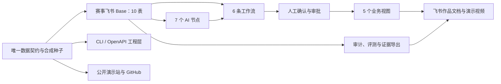

# 石听 NeoLoop A+ 完整实施计划

日期：2026-08-01
状态：实施中；第四轮本地集成通过，单案闭环、公开体验候选和评委材料已收口；Excel 原生格式、W6 改进闭环与现场飞书权限门仍未通过
适用范围：2026 AI 先锋未来人才大赛 40 强赛作品
团队：石听未来
产品：石听 NeoLoop

> 让每条反馈都找到一辆车、一个任务、一个责任人和一次改进。

## 0. 主控、并行任务与偏航检查

本文件是实施阶段的唯一主计划。规格基线为 `../specs/2026-08-01-shiting-neoloop-a-plus-design.md`。实施可以并行，但不能让各子任务自行改变数据契约、业务边界、事实口径和发布状态。

### 0.1 主控职责

主控负责：

- 维护共享契约、阶段依赖、验收门和任务状态。
- 划分文件所有权，避免多个任务同时修改同一模块。
- 审核子任务结果，运行集成测试，决定是否进入下一轮。
- 统一处理 Git、飞书权限、公开材料、部署和 Lunar OS 交接。
- 不因时间压力静默删除 D0、D1 或 D2 工作项。

### 0.2 可并行任务线

| 任务线 | 主要责任 | 初始文件所有权 | 前置条件 |
|---|---|---|---|
| T0 主控与集成 | 契约冻结、任务编排、跨模块验收、Git 与发布 | 主计划、共享契约入口、集成测试 | 无 |
| T1 数据与评测 | 旧 Excel 迁移、10 表合成种子、金标准、安全集、三份 Excel | `data/canonical/`、迁移与评测数据、Excel 生成器 | 规格已批准 |
| T2 飞书落地 | 第一天权限矩阵、Base manifest、视图、AI 节点、工作流和人工配置手册 | `feishu/`、飞书验收记录 | 共享字段与状态枚举冻结 |
| T3 工程内核 | contracts/domain/AI/workflows/CLI/OpenAPI、单元和契约测试 | `src/neoloop/`、`services/openapi-ingest/`、相关测试 | 共享契约冻结 |
| T4 体验与内容 | 公开站、GitHub 文档、飞书作品文档、视觉附录、视频脚本 | `app/`、公开快照消费层、作品文档与视觉资产 | canonical public 快照冻结 |

第一轮只并行启动 T1、T2、T3；T4 先读取规划并准备内容骨架，不得在 canonical public 快照冻结前重写业务数据。主控保留共享契约和集成文件的最终写权限。

### 0.3 分级回读与偏航检查

2026-08-02 经参赛者确认，回读改为“每轮一次完整回读、关键边界变更追加回读、小任务简版自检”。目标是保留防偏航能力，同时避免机械回读挤占实施和测试时间。

每轮开始时：

1. 主控完整读取本实施计划和 A+ 设计规格，并检查与本轮直接相关的现有文件。
2. 子任务负责人读取本轮相关章节、共享契约和直接相关文件；只有跨任务线或触碰关键边界时才要求完整回读。
3. 主控确认前置条件、文件所有权和并行冲突后再下达任务。

轮内的小改动、补测试和表现层调整只执行简版自检，不重复全文回读。简版自检至少确认：

- 是否仍在已批准的任务范围和文件所有权内。
- 是否触碰数据契约、状态机、事实口径、权限边界或发布状态。
- 是否会覆盖、回退或误用其他任务线的并行修改。

出现以下任一情况时，主控必须追加完整回读本计划和 A+ 设计规格，再决定是否继续：

- 修改数据契约、固定枚举、状态机或工作流顺序。
- 修改人工关口、授权模型、安全边界或事实分类口径。
- 改变 D0、D1、D2 范围、验收门槛、真实/合成状态或发布状态。
- 发现跨任务线冲突、计划外依赖，或需要改变已批准设计。

每轮收口时，由主控再完整回读一次本实施计划；各任务线提交简短偏航检查，至少回答：

- 本轮完成了哪一项计划任务，证据在哪里。
- 是否修改了本任务线之外的文件。
- 是否改变了数据契约、状态机、事实口径、权限边界或交付范围。
- 是否出现未在计划中的假设、依赖或风险。
- 下一轮是否仍满足前置条件。

偏航检查结果只能是：`未偏离`、`已纠正`、`需要主控裁决`。子任务不得自行修改本计划；确需改变已批准设计时，由主控停止集成并向参赛者报告。

每轮结束的固定顺序为：

```text
子任务自测
→ 子任务简版偏航检查
→ 主控审阅
→ 集成测试
→ 主控完整回读主计划
→ 记录阶段证据
→ 决定是否进入下一轮
```

### 0.4 当前执行快照

截至 2026-08-02 第四轮主控集成收口：

- T1 已冻结只读 canonical public 快照 `1.0.0-t1-r3-public.1`：14 个文件，覆盖 30 条反馈、20 个案件、27 张工单、10 个问题簇、10 个改进项目、1 条主故事、4 类故障和 5 个只读视图。数据测试 23/23；canonical 与 public validator 均为零错误、零警告，public manifest SHA-256 为 `3fb3dbff876eb0619ed7037be65db862b30a52bdee76df70e57b425661e0cae3`。
- 三份 Excel 共 26 张 sheet 的内容、公式、筛选、验证和视觉预览仍通过，但冻结窗格与打印区域没有持久化，因此继续保留原生格式阻断，不得表述为最终格式完成。
- T2 已增加第一天 P01—P13 探针、10 表导入 DAG、5 组 smoke 和结果空模板；离线门为 80/80、152/152、213/213。13 项探针、70 条执行记录、41 个现场证据单元、48 个 R3 资源字段、300 个资源值槽和 3 个平台角色映射仍全部未测试或为空，7 节点与 6 工作流仍是未配置待测，未创建真实 Base。
- T3 已完成 N7 三种草稿模式、W5 验证回访和 `SYN-CASE-017` 单案本地合成闭环。授权等待期间的命令可变性、repository 直写绕过和 W4×W5 丢更新均经过确定性失败用例后纠正；最终 local 126/126、cross-contract 4/4、full 130/130，独立复审 P0=0、P1=0。该证据只覆盖单进程 in-memory fake，不外推到数据库事务、企业 IAM、真实送达或生产并发。
- T4 已完成只读公开站候选、评委文稿、4 分 40 秒视频脚本和 10 页 A4 横版视觉附录。网站契约 3/3、SSR 渲染 2/2；PDF SHA-256 为 `8c8e94f40305c3a8e8e013006490a5552f2453d98e245b17ef3c3e8120a52b38`，所有页面仍明确区分公开事实、待企业验证、方案设计和合成实验。新版尚未推送或部署。
- 发布依赖已把 Next 与 eslint-config-next 升至 16.2.12，并把 Next 依赖树内的 PostCSS 固定为 8.5.25、sharp 固定为 0.35.3；生产依赖审计为 0。精确 Node 22.13.0 下核心 130/130、网站 3/3、lint、SSR、Vinext 构建和 Netlify 静态导出均通过。完整开发/构建依赖审计仍有 45 个节点级告警，需单独升级和回归，不能写成“全依赖零漏洞”。
- 本轮没有真实飞书/OpenAPI/LLM 调用，没有车辆控制，没有推送 GitHub，也没有部署新版本。P01—P13、企业数据、责任矩阵、SLA、通知到达、Excel 原生格式和 W6 跨事件改进闭环仍待完成或验证。

主控证据记录：`../records/2026-08-01-round-1-integration.md`、`../records/2026-08-01-round-2-integration.md`、`../records/2026-08-01-round-3-integration.md`、`../records/2026-08-02-round-4-integration.md`。

## 一、目标与完成口径

本轮实施覆盖 D0、D1、D2，不因时间紧张删除工作项。执行顺序仍为“先把核心闭环做稳，再接工程层和增强项”。

飞书不是单纯展示页：

- 飞书 Base 是业务数据主源。
- 飞书 AI、自动化、审批和视图承担核心运行。
- 本地代码负责数据契约、规则、测试、导入、OpenAPI、评测、证据导出和公开演示。
- Netlify 站点只展示脱敏合成快照，不连接真实 Base，也不保存飞书凭证。



全部完成后应交付：

- 赛事飞书中的 10 表、5 视图、7 节点、6 工作流和 3 个逻辑业务角色。
- 一条 `SYN-CASE-017` 主故事及四类故障演练。
- 权限矩阵、字段字典、评测集、审计记录、故障记录和合成流程对照实验。
- lark-cli 能力检查、自编 CLI、OpenAPI 幂等接入、导入与评测工具。
- 妙搭业务前台、Aily 入口、公开演示站和扩展示例。
- 填写完成的飞书作品文档、约 4 分 40 秒视频、视觉附录、GitHub 复现说明。
- 匿名访问、无特权访问、预览部署、生产部署和最终链接验收记录。

## 二、技术设计与固定接口

### 1. 代码与数据边界

在现有单仓库内建立以下边界：

```text
src/neoloop/
  contracts/          数据结构、枚举、AI输出、工作流事件
  domain/             幂等、硬规则、状态机、SLA、证据完整度
  ai/                 N1-N7提示词、校验、重试和审计
  workflows/          W1-W6确定性编排
  adapters/feishu/    Base映射、能力探测、API错误归一化
  evaluation/         金标准、安全集、指标和对照实验
  cli/                capability/schema/seed/ingest/eval/export

data/canonical/
  tables/             10表合成种子
  scenarios/          主故事与四类故障
  gold/               20案人工金标准
  adversarial/        安全、拒答和提示注入样例
  public/             供公开站使用的脱敏快照

feishu/
  manifests/          表、字段、视图、节点、工作流期望配置
  runbooks/           权限验收、人工搭建、回退和排错手册

services/openapi-ingest/
  独立接入服务；不进入公开站构建
```

约束如下：

- `app/` 只能读取 `data/canonical/public`。
- 现有 `app/page.tsx`、`data/demo-cases.json`、`docs/app.js` 不再各自维护数据，全部由 canonical 数据生成。
- `db/schema.ts` 不发展成第二业务数据库；核心持久化仍是 Base。
- Base 的 app token、table ID、field ID 只进入忽略的本地映射文件。
- 凭证只放系统钥匙串、飞书 CLI 凭证库或部署平台密钥，不进聊天、仓库、截图和视频。

### 2. 10 张 Base 表

所有表统一带有 `schema_version`、`data_scope`、创建时间、更新时间和来源标识。赛事合成数据的 `data_scope` 固定为 `synthetic_experiment`。

| 表 | 核心字段与关系 |
|---|---|
| 原始反馈 | `feedback_id`、渠道、原文、接收时间、来源记录号、授权范围、幂等键、处理状态、关联案件；原文不可被 AI 覆盖 |
| 反馈案件 | 标题、摘要、分类、规则风险、AI 风险、最终风险、状态、缺失项、实体候选、正式实体、证据完整度、SLA 起点与规则版本 |
| 处置工单 | 案件、团队、责任人、动作、接单时间、到期时间、处置证据、验证结果、升级级别；改派不得重置 SLA |
| 问题簇 | 成员案件、聚类模式与版本、根因假设、支持证据、反证、审核状态、复发记录 |
| 改进项目 | 问题簇、版本、负责人、措施、观察窗、时钟来源、指标公式、7 天与 30 天结果、人工结论 |
| 车辆档案 | 车辆 ID、车型、版本、站点、状态快照、来源时间；不含车辆控制动作 |
| 配送任务 | 任务 ID、车辆、站点、路线、任务状态、起止时间、来源时间 |
| 站点责任矩阵 | 区域、站点、问题类型、默认团队、审核人、升级路径、SLA 版本、生效时间 |
| 知识索引 | 文档链接、适用范围、负责人、版本、审核状态、生效时间 |
| AI 审计 | 运行 ID、对象引用、节点与模式、版本、输入哈希、输出 JSON、校验、重试、人工决定和错误分类 |

固定状态：

- 原始反馈：`待分诊、人工处理、已建案、已忽略`。
- 案件：`待补充、待关联、待派单、处理中、待验证、待回访、已关闭、已合并`。
- 问题簇：`候选、待审核、改进中、观察中、已归档、已驳回`。
- 工单：`待接单、处理中、待验证、已完成、已取消`。
- 改进项目：`待立项、执行中、观察中、已完成、已终止`。
- 提醒和升级是独立字段，不增加案件状态。

### 3. 旧数据迁移决定

报名 Excel 保持原文件不变，先记录 SHA-256，再生成新版数据。

编号统一采用以下规则：

- 原舱门案例 `DEMO-C-002` 迁移为规格锁定的 `SYN-CASE-017`。
- 原冷链案例 `DEMO-C-017` 迁移为 `SYN-CASE-002`。
- 其他 `DEMO-C-n` 按序迁移为 `SYN-CASE-n`。
- 所有对象保留 `legacy_id`，迁移表必须一一对应、无重复、无漏项。

状态迁移规则：

- `已分诊`：字段完整时转为`待关联`，否则转为`待补充`。
- `待人工确认`：转为`待关联`，同时保留待确认事项。
- 案件中的`观察中`不再作为案件状态；案件根据回访证据转为`待回访`或`已关闭`，长期观察转入改进项目。
- 旧“关联模式=自动”只能迁移成“候选生成方式=AI”，正式确认状态统一设为待人工确认。
- 任一未知状态、孤立外键或重复主键都让迁移失败，不静默修复。

生成三份格式化 Excel：

1. `NeoLoop_数据模型与导入.xlsx`：字段字典、迁移表和 10 张业务表。
2. `NeoLoop_验收与评测.xlsx`：权限矩阵、金标准、安全集、节点结果、工作流结果和证据索引。
3. `NeoLoop_流程对照实验.xlsx`：随机分组、原始计时、人工操作、错误记录和汇总结果。

工作簿统一设置冻结窗格、筛选、数据验证、自动换行、合理列宽、合成数据标识和打印区域。

### 4. 公共类型和运行接口

核心类型固定为：

- `EvidenceClass = public_fact | enterprise_pending | solution_design | synthetic_experiment`
- `ClockSource = real | test | synthetic_history`
- `IngestRequest / IngestResult`
- `AiNodeEnvelope<T>`
- `WorkflowEvent / WorkflowResult`
- `Clock、IdGenerator、Repository、AiNodeRunner、AuditSink、Notifier`

`AiNodeEnvelope<T>` 必须包括：

- 节点、模式、版本、运行 ID、对象引用。
- 输入哈希和结构化 payload。
- 证据片段、缺失项、置信度。
- `ok、needs_human、refused、error` 状态。
- JSON 校验结果、重试次数和人工修改。

AI 输出不合结构时，只允许使用同一版本修正重试一次；再次失败即停止节点链并转人工处理。

项目 CLI 固定提供：

```text
neoloop capability check
neoloop schema diff
neoloop schema apply --dry-run
neoloop seed validate
neoloop seed import
neoloop ingest
neoloop eval ai
neoloop eval workflows
neoloop export evidence
```

CLI 采用 JSON 输出和稳定退出码：

- `0`：成功或幂等命中已有记录。
- `2`：输入或契约错误。
- `3`：配置或权限不足。
- `4`：上游限流、超时等暂时故障。
- `5`：批处理部分失败，可从检查点续跑。

独立 OpenAPI 接口为 `POST /v1/feedback`：

- 要求时间戳、nonce、HMAC 签名及幂等键。
- 同键同内容返回已有 `feedback_id`，不新增记录。
- 同键不同内容返回 `409 idempotency_conflict`，不覆盖旧记录。
- 不同键但内容相似时分别接入，由 N5 判断业务重复。
- 请求超过五分钟、nonce 重放或签名错误时拒绝。
- 服务默认不公开部署；只有自建应用、管理员批准和独立密钥存储均通过后才启用。

### 5. 七个 AI 节点

- N1：原文事实、诉求、对象线索、缺失项；每条事实必须指向原文片段。
- N2：业务域、二级类别、标签和词典版本。
- N3：风险建议、触发证据和解释；最终风险由系统取硬规则与 AI 建议中的较高值。
- N4：车辆、任务、站点候选及逐项证据；只生成候选。
- N5：严格分成“同事件重复”和“跨事件聚类”两种模式。
- N6：严格分成“责任路由建议”和“根因假设”两种模式，必须同时输出支持证据与反证。
- N7：严格分成“客户回复、知识草稿、洞察摘要”三种模式，引用只能来自已审核知识。

原始反馈按不可信数据处理，提示词明确禁止执行原文中的指令。AI 不获得车辆控制、最终判责、赔偿、恢复时间、正式结案和知识发布权限。

### 6. 六条工作流实施顺序

严格按以下顺序集成：

```text
W1接入幂等
→ W2风险分诊
→ W6同事件重复检查
→ W3关联派单
→ W4 SLA协同
→ W5验证与回访
→ W6跨事件聚类、改进与观察
```

任何一步失败都保留原状态、原 SLA 起点和审计记录，不允许“为了继续演示”自动跳过人工关口。

## 三、实施阶段与时间安排

| 日期 | 工作 | 退出条件 |
|---|---|---|
| 8月1日 | 保护现有 Git 修改；运行 Lunar OS `prepare`；建立实施分支；完成飞书第一天权限验收 | 权限矩阵有实际测试动作、结果、限制、截图和保底路径 |
| 8月2日 | 冻结 canonical 契约；迁移旧 Excel；生成 10 表 manifest、字段字典和三份 Excel 骨架 | 30反馈、20案件、27工单、10问题簇全部可追溯，零孤立外键、零未映射状态 |
| 8月3日 | 创建 Base 10 表、管理员视图和 5 个业务视图；建立角色权限、硬规则、SLA 与 AI 审计底座 | 无特权账号可进入允许视图，关键字段和状态受保护 |
| 8月4日 | 完成 N1—N3、W1、W2 和 W6 同事件检查 | 同键幂等、异键相似、缺失字段和 JSON 错误均按规格运行 |
| 8月5日 | 完成 N4、N6 责任路由、W3 和 W4 | 主故事可完成实体候选、人工确认、派单、接单、提醒和超时升级 |
| 8月6日 | 完成 N7、W5，跑通单案闭环 | `SYN-CASE-017` 可从接入重复跑到人工关闭，证据轨迹完整 |
| 8月7—8日 | 完成 N5 跨事件聚类、N6 根因假设、改进项目、7/30 天测试时钟和知识审核 | 问题簇可从候选进入改进、观察、归档和复发重开 |
| 8月9日 | 执行 D0 正常路径、安全对抗和四类故障验收 | D0 安全门槛全部通过，异常均有审计和人工接管 |
| 8月9—10日 | 完成 20 案交叉顺序合成流程对照实验 | 有原始记录、样本量、中位数、范围和错误样例 |
| 8月10—12日 | 完成 D1：lark-cli、项目 CLI、OpenAPI、评测导出、GitHub 文档、妙搭和公开站升级 | 每项均有代码、测试、复现步骤和现场证据 |
| 8月12—13日 | 完成飞书文档主体、HTML/SVG 图表、核心视频初剪和链接说明 | 文档覆盖官方必含模块，核心视频在 3—5 分钟内可完整观看 |
| 8月14日 | 完成 D2：Aily、视觉升级、扩展示例和视觉附录；将通过验收的增强项并入最终视频 | D2 不改变核心状态机；所有展示内容使用同一数据契约 |
| 8月15日 | 内部冻结、全链复验、匿名访问和无特权访问复查 | 文档、Base、视频、公开站、GitHub 和证据版本一致 |
| 8月16日 | 最终人工复核和提交 | 由参赛者本人在 23:59 前提交并保存回执 |

并行安排：

- 用户进行登录、OAuth 或管理员审批时，并行完成字段字典、金标准和文档骨架。
- N1—N3、N4/N6、N5、N7 可并行开发，但必须按工作流主链依次集成。
- D1 的 CLI、公开站、妙搭和评测工具可并行，共享同一 canonical 契约。
- 文档从数据契约冻结后持续更新；最终能力名称、数字和截图只能在现场验收后写实。
- D0、D1、D2 均保留。若平台能力确实不可用，仍完成对应提示词、接口、测试和可部署包，并保留权限阻断证据，但不得声称已在飞书中上线。

### 第一天权限验收清单

1. 确认赛事账号所属租户、可创建空间和外部分享范围。
2. 在临时 Base 验证表、字段、关联、公式、视图、表单和自动化。
3. 验证飞书 AI 的结构化输出、调用限制和运行记录。
4. 验证条件分支、审批、提醒、机器人和异常通知。
5. 验证知识库读取、引用和发布审核。
6. 分别验证妙搭和 Aily；不以其中一项代替 Base 核心。
7. 验证是否允许创建企业自建应用及管理员审批流程。
8. 确认赛事允许使用官方 [lark-cli](https://github.com/larksuite/cli)，再执行安装、`auth login --recommend`、`auth status`、`auth scopes` 和 `auth check`。
9. 通过 [Base OpenAPI](https://open.feishu.cn/document/server-docs/docs/bitable-v1/bitable-overview?lang=zh-CN) 实际能力检查确定权限；写入使用当前 `bitable:app`，不申请已废弃的旧权限。
10. 使用无特权账号检查五个业务视图。
11. 创建临时文档并开启“互联网获得链接可阅读”，用未登录无痕窗口验证。
12. Base 登录权限和文档匿名权限分别记录，不互相替代。

## 四、测试、证据与内容交付

### 1. 自动测试

新增 Vitest、Playwright、Zod、ExcelJS 和必要的覆盖率工具。

测试层次：

- 契约测试：10 表结构、枚举、关系、时间格式和公共快照脱敏。
- 迁移测试：固定验证 30/20/27/10 数量、主故事编号交换和零孤立外键。
- 领域测试：幂等、规则优先、状态守卫、SLA 不重置、重开和测试时钟。
- AI 测试：七节点 Schema、证据引用、一次重试、拒绝虚构和人工降级。
- 工作流测试：六条正常路径、退回、回访异常、升级失败、复发重开。
- OpenAPI 测试：签名、重放、并发同键、限流、超时和无权限。
- Feishu 适配测试：内存 fake、录制响应和授权后的 live smoke 分开。
- Web E2E：五个页面、主故事、四类故障、键盘操作、焦点、Esc、移动端和无横向溢出。
- 发布测试：Node 22.13.0 下 fresh install、lint、typecheck、测试、构建、静态导出和部署哈希。

`contracts/domain/workflows` 的行覆盖率与分支覆盖率均不低于 85%。真实飞书凭证测试不进入公共 CI。

### 2. 固定验收门槛

- 合成安全集 P0/P1 风险召回率为 100%。
- 禁止自动动作次数为 0。
- 幂等重试覆盖旧业务记录次数为 0。
- 四类故障进入正确安全路径的比例为 100%。
- 七节点运行审计覆盖率为 100%。
- 正式实体、责任人、回复、结案、根因和知识发布均保留人工确认。
- 7 天与 30 天结果全部标明真实、测试或合成历史时钟。
- 实体关联、责任路由和草稿质量只报告实测值与错误样例，不预写漂亮百分比。
- 没有真实任务量分母时只报告复发数，不写复发率。
- 合成结果不外推为新石器真实效率、收入或 ROI。

安全集除现有 20 案金标准外，再补充 16 个对抗样例，覆盖高风险、提示注入、车辆控制、自动判责、赔偿、恢复时间、最终根因和未审知识发布。

### 3. 合成流程对照实验

- 20 个案件每案分别跑一次人工 SOP 和一次 NeoLoop。
- 使用固定随机种子分成 AB/BA 两组，抵消学习顺序。
- 记录操作者、顺序、起止时间、人工操作次数、证据遗漏、路由修改和高风险漏检。
- 报告中位数、范围、样本量和错误样例，不只给平均值。
- 原始记录和汇总公式保存在 Excel；飞书文档只放可读摘要。
- 标题固定写“合成流程对照实验”，不写“企业实际提升”。

### 4. 四类事实的统一管理

建立唯一“证据与声明台账”，每条公开表述必须属于一种：

| 类型 | 必备信息 |
|---|---|
| 公开事实 | 来源链接、资料名称、获取日期、适用范围 |
| 待企业验证 | 验证问题、责任人、需要的证据、当前状态 |
| 方案设计 | 规格版本、设计内容、是否已经实现 |
| 合成实验 | fixture 版本、运行 ID、样本量、时钟来源和结果文件 |

文档、网站、Excel、视频字幕和 GitHub 使用同一分类。任何没有运行证据的设计都不能标成“已验证”。

### 5. 飞书作品文档

按官方模板制作，但删除模板中的评分维度表。正文顺序为：

1. 信息卡与一句话价值。
2. 命题场景、公开事实和待验证问题。
3. Before/After。
4. 五个有现场证据的创新点。
5. 单案闭环和改进闭环。
6. 10 表、7 节点、6 工作流及人工关口。
7. 四类故障与安全降级。
8. 合成流程对照结果和企业复测方法。
9. 体验入口、打开说明和视频。
10. CLI/OpenAPI、推广映射、参考来源和团队补充。

面向评委的 Markdown 文稿完成后使用 humanizer 做自然化处理，再人工复核事实、数字和专业术语；Schema、运行手册和代码文档不做文学化改写。

### 6. 视觉、网站和视频

- 架构图、流程图和指标图使用 HTML、SVG 或可复算图表。
- 图像生成只用于封面、场景插画和装饰资产，不用生成事实图、实验数据或运行截图。
- 更新一份 HTML 制作的视觉附录，导出为 PDF；是否附在提交文档中取决于链接和篇幅验收。
- 公开站升级为同一合成数据契约下的五视图回放，增加主故事、四类故障、证据标签和版本号。
- 保留现有 Netlify URL；公开站不读取赛事 Base。
- Aily 默认只提供查询、解释和草稿能力；写操作只能生成待审批建议，不提供车辆控制工具。
- 扩展示例采用“制造售后”和“园区服务”两套合成映射，只证明结构可配置。

视频目标约 4 分 40 秒：

- 0:00—0:25：命题、问题和事实边界。
- 0:25—2:15：`SYN-CASE-017` 单案闭环。
- 2:15—3:00：问题簇、改进项目和测试时钟。
- 3:00—4:10：完整展示 ID 缺失和 SLA 超时；另外两类故障用审计记录快速说明。
- 4:10—4:40：合成对照结果、体验入口和结束页。

上传后必须在未登录环境完整播放，检查权限、声音、字幕、清晰度和敏感信息。

### 7. Git、CI 与发布

实施开始前：

- 记录当前 `233985c`、远端差异和四个既有脏文件。
- 保存现有 diff，建立隔离分支/工作树，不覆盖或回退用户修改。
- 既有修改先单独保存为基线提交，再开始业务实现提交。
- 每个阶段使用小提交，数据契约、飞书核心、工程层、网站、文档分开。

CI 使用 Node 22.13.0，执行类型检查、单元/契约测试、E2E、构建、高风险依赖审计和密钥扫描。Live Feishu 测试只在本地授权环境运行。

网站发布沿用现有流程：

1. 候选版本冻结。
2. 本地完整检查。
3. 桌面 1440×1024、移动 390×844 浏览器验收。
4. Netlify 预览部署。
5. 用户批准预览。
6. GitHub 同步。
7. 用户批准生产发布。
8. 同一构建产物晋级生产。
9. HTTPS、资源、核心文案和哈希复验。
10. 写入发布记录和 Lunar OS 交接。

未经用户批准不推送远端、不部署正式环境。

## 五、责任、假设与最终验收

### 技术协作负责

- 数据迁移、代码、节点契约、提示词、状态机、工作流、CLI、OpenAPI、测试和排错。
- Base/妙搭/Aily 的配置方案和可执行操作。
- Excel、作品文档草稿、图表、视觉附录、网站、视频脚本与后期技术处理。
- GitHub 文档、CI、部署预览、验收报告和项目记忆交接。

### 参赛者本人负责

- 飞书登录、OAuth、管理员审批及必须本人点击的授权。
- 凭证创建、保管和轮换。
- 两名成员真实介绍、实际分工和公开授权范围的确认。
- 企业数据的合法授权及企业口径确认；没有授权则全程使用合成数据。
- 飞书文档互联网分享开关、Base 测试账号或打开说明。
- 最终作品复核、提交和回执保存。

### 已采用的假设

- 当前已入围且赛事账号可以登录，但具体权限尚未验收。
- 当前没有新石器真实业务数据、字段字典、责任矩阵、SLA 或生产接口。
- `lark-cli` 尚未安装，OpenAPI 能否启用以第一天实测为准。
- D0、D1、D2 均进入实施范围；平台权限不足时不伪造运行结果。
- 内部冻结时间为 8 月 15 日，最终提交截止按 8 月 16 日 23:59 处理。
- 现有公开站和 GitHub 地址继续使用，正式发布仍需用户批准。
- 本计划响应了用户恢复规划的明确指令，原“暂停在实施计划前”的状态在实施启动时更新。

### 最终完成标准

只有以下条件全部满足，才进入最终提交复核：

- 10 表、5 视图、7 节点、6 工作流均有实际运行证据。
- 主故事和四类故障可以从干净种子重复运行。
- D1 代码、CLI、OpenAPI、公开站和妙搭都有测试与复现说明。
- D2 的 Aily、视觉升级和扩展示例已经实施，或有明确的平台权限阻断证据及完整可部署包。
- 三份 Excel、飞书文档、视频、视觉附录、GitHub 和公开站使用同一版本数据。
- 所有事实标签、合成声明、成员授权和数据边界一致。
- 飞书文档匿名访问、Base 无特权访问、视频匿名播放、Netlify 和 GitHub 均已复验。
- 无密钥、真实客户数据、未经授权个人信息或虚构企业成效。
- 用户本人完成最终提交并保存回执。

8 月 15 日正常验收完成后，提醒用户是否启动“三次九轮协议”。建议三次分别验证事实与评分证据、异常流程与权限、最终链接与演示；未获得明确确认前不启动，也不把它设为隐含完成门。
