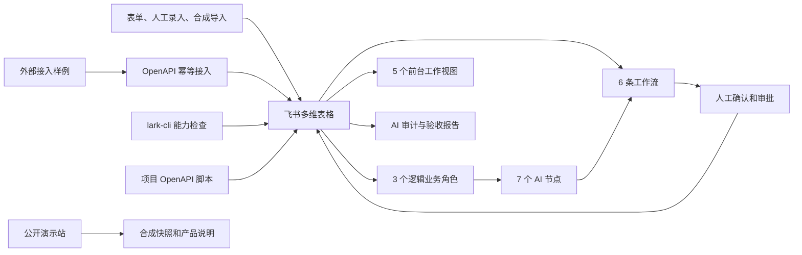

# 石听 NeoLoop A+ 设计规格

日期：2026-08-01
状态：设计已批准，等待实施计划
适用范围：2026 AI 先锋未来人才大赛 40 强赛作品
团队：石听未来
产品：石听 NeoLoop

> 让每条反馈都找到一辆车、一个任务、一个责任人和一次改进。

## 1. 这次要做什么

企业命题是“依托飞书 AI 搭建无人配送全渠道用户反馈闭环运营体系”。作品要覆盖反馈归集、智能分拣、闭环处理和主动洞察，并能在赛事飞书环境中演示。

NeoLoop 处理反馈进入企业后的协同链路，并避开 NeoClaw 已公开的查车、发车、开门、充电调度和经营问答能力。系统要回答一组具体问题：原文有没有保存，涉及哪辆车和哪个任务，证据是否足够，应该由谁处理，是否按时完成，同类问题有没有再次发生。

作品范围按竞赛 POC 控制。当前已确认赛事账号可以登录，具体能力仍要逐项验收。企业真实字段、责任矩阵、SLA、合规样本和业务基线尚未在本项目中验收或确认可用，因此实施阶段先使用明确标记的合成数据。

## 2. 目标和非目标

作品需要跑通两条闭环。

1. 单案闭环：反馈接入、理解与分诊、实体关联、人工派单、处置协同、解决验证、回访关闭。
2. 改进闭环：重复识别、问题簇审核、根因假设、改进项目、7 天观察、30 天观察、知识沉淀。赛事演示使用测试时钟或合成历史时间戳。

以下内容不在范围内：

- 不执行车辆控制或调度指令。
- 不自动降低高风险等级。
- 不自动认定事故责任、赔偿、恢复时间或最终技术根因。
- 不自动发布客户回复或知识条目。
- 不生成不存在的车辆 ID、任务 ID、客户事实或企业成效。
- 不把公开演示站当作企业生产系统。

## 3. 事实口径

文档、界面、视频和代码说明统一使用四类标签。

| 类型 | 可以写什么 | 不可以写什么 |
| --- | --- | --- |
| 公开事实 | 官方命题、公开产品能力和可核验资料，并附来源 | 根据公开页面猜测企业内部系统和流程 |
| 待企业验证 | 权限、真实字段、责任矩阵、SLA、数据基线和已有能力 | 把未确认内容写成企业现状 |
| 方案设计 | 单 Base、Agent、AI 节点、工作流、审批和验证方法 | 把设计稿写成已经上线的系统 |
| 合成实验 | 明确标记的车辆、任务、反馈、案件、故障注入和测试结果 | 把合成结果写成真实客户案例或经营成效 |

## 4. 总体架构

实施后，飞书将作为业务主系统，代码作为工程辅助层。OpenAPI 不会成为核心闭环的单点依赖。



### 4.1 组件职责

| 组件 | 职责 | 依赖和边界 |
| --- | --- | --- |
| 飞书多维表格 | 保存业务对象、关系、状态、规则和审计记录 | 实施后作为赛事作品的数据主源，不包含车辆控制字段 |
| 逻辑业务角色 | 以“听懂、跟进、复盘”三个视角组织视图、节点和工作流 | 不是三个独立运行服务，不维护独立会话，也不依赖 Aily |
| AI 节点 | 输出结构化建议、证据、置信度和草稿 | 输出必须通过结构校验，关键结论由人确认 |
| 工作流 | 执行确定性步骤、提醒、升级、审批和回访 | 不替代人的最终判断，不悄悄重置 SLA |
| lark-cli | 在权限验收后用于本地登录、能力检查和已确认支持的 OpenAPI 调用 | 实际能力以第一天测试结果为准，不把它写成通用部署工具 |
| 项目 OpenAPI 脚本 | 负责幂等接入、合成导入、批量评测和导出中确有必要的部分 | 仅在自建应用、权限和接口实测通过后启用 |
| 飞书原生导入和自动化 | 承担 Base 内可以直接完成的配置、导入、提醒和审批 | 优先使用原生能力，不为展示代码而重复开发 |
| 妙搭或飞书应用页 | 提供更集中的业务操作入口 | 权限或稳定性不足时，退回 Base 五个视图 |
| 公开演示站 | 提供无需赛事账号的产品说明和合成交互回放 | 不连接真实 Base，不保存企业数据或凭证 |

## 5. 单 Base 数据模型

Base 使用 10 张关联表。每张表只承担一种主要职责，避免把案件、工单和改进记录混在同一行。

| 表 | 主键与主要字段 | 关系和写入规则 |
| --- | --- | --- |
| 原始反馈 | `feedback_id`、渠道、原文、接入时间、来源记录号、授权范围、幂等键、处理状态 | 原文不可被 AI 覆盖。处理状态只使用“待分诊、人工处理、已建案、已忽略” |
| 反馈案件 | `case_id`、标题、分类、风险等级、状态、实体候选、证据完整度、SLA 起点、SLA 规则版本 | 一个案件可关联多条原始反馈和多张工单。SLA 起点按接入时间或企业确认的固定事件生成，改派不得重置 |
| 处置工单 | `work_order_id`、案件、承接团队、责任人、动作、到期时间、处置证据、验证结果 | 责任人和结案状态由授权人员确认 |
| 问题簇 | `cluster_id`、名称、聚类规则版本、成员案件、根因假设、支持证据、审核状态 | 不同事件可以进入同一问题簇，但不能合并成同一案件 |
| 改进项目 | `improvement_id`、问题簇、负责人、措施、观察窗、时钟来源、指标公式、7 天结果、30 天结果 | 一个问题簇可以有多个版本化改进项目。赛事演示记录测试时钟或合成历史时间戳 |
| 车辆档案 | `vehicle_id`、车型、版本、所属站点、状态快照、来源时间 | 只保存查询和关联所需快照，不提供控制动作 |
| 配送任务 | `task_id`、车辆、站点、路线、任务状态、起止时间、来源时间 | 作为案件关联证据，不自动改写企业任务状态 |
| 站点责任矩阵 | `routing_rule_id`、区域、站点、问题类型、默认团队、审核人、升级路径、SLA 版本 | 规则变更需要版本号和生效时间 |
| 知识索引 | `knowledge_id`、文档链接、适用范围、负责人、版本、审核状态、生效时间 | 只索引经人审核的 SOP 和答复模板 |
| AI 审计 | `run_id`、对象引用、节点版本、输入哈希、输出 JSON、置信度、校验结果、重试次数、人工修改 | 不重复保存不必要的敏感原文，公开导出必须脱敏 |

外部来源有稳定记录号时，幂等键按“租户范围、渠道、来源记录号”组合后计算哈希；表单使用响应 ID，文件导入使用文件哈希和行号。来源没有稳定记录号时，W1 为本次接入生成唯一键，内容相似问题交给 N5 判断，不能用文本哈希直接吞掉一条可能独立的反馈。

### 5.1 前台只展示五个视图

- 反馈收件箱：看新反馈、重复候选、缺失项和分诊状态。
- 案件驾驶舱：看案件事实、实体证据、工单、回访和审计摘要。
- SLA 协同板：按责任人、到期时间和升级状态管理工单。
- 问题地图：查看问题簇、站点、车型、版本和时间分布。
- 改进追踪：查看改进项目、观察窗、复发数和审核结论。

车辆、任务、责任矩阵、知识索引和 AI 审计保留在管理员视图。评委如果需要，可以从案件记录继续下钻查看，不让 10 张表同时出现在主界面。

## 6. Agent 和 AI 节点

三个 Agent 名称只表示逻辑业务角色和编排视角，七个节点才是可单独测试的能力单元。三个角色不维护独立会话、工具状态或权限，也不要求赛事环境提供 Agent 容器。Base 视图、AI 节点和工作流按这三个角色分组；Aily 如果可用，只增加一个对话入口，不改变核心流程。

| 编号 | 节点 | 主要调用者 | 输入 | 输出 | 限制 |
| --- | --- | --- | --- | --- | --- |
| N1 | 结构化抽取 | 反馈理解 Agent | 原始反馈和渠道元数据 | 事实片段、诉求、对象线索、缺失项 | 不补写原文没有的事实 |
| N2 | 业务分类 | 反馈理解 Agent | N1 输出、分类词典 | 问题域、场景、建议标签和置信度 | 分类词典需要版本号 |
| N3 | 风险建议 | 反馈理解 Agent | 原文、N1 输出、硬规则结果 | 风险建议、触发证据和解释 | AI 只能提高风险，不能覆盖更高的规则结果 |
| N4 | 实体关联 | 案件协同 Agent | 车辆、任务、站点候选和事实片段 | 候选对象、逐项证据和置信度 | 正式关联必须由人确认 |
| N5 | 重复识别与聚类 | 改进洞察 Agent | 案件事实、时间和实体信息 | 重复候选、相似度、建议问题簇 | 同事件并案和跨事件聚类必须分开 |
| N6 | 根因假设与责任路由 | 案件协同 Agent，改进洞察 Agent可调用 | 证据、责任矩阵、问题簇和处置记录 | 责任候选或根因假设、支持证据、反证 | 不输出最终责任或最终技术根因 |
| N7 | 回复、知识与洞察草稿 | 案件协同 Agent和改进洞察 Agent共享 | 已审核事实、处置结果、知识索引 | 三种模式的草稿和引用 | 所有草稿发布前必须人审 |

N6 和 N7 都支持模式化调用。N6 的“责任路由”服务于单案，节点归案件协同 Agent 管理；问题簇通过同一节点请求“根因假设”。N7 只有一个版本和一套审计方式，避免为三种草稿重复建设节点。

N5 使用两套分开的输出结构。“同事件重复”模式根据来源记录号、时间、车辆、任务和事实片段生成并案候选；“跨事件聚类”模式为不同案件生成问题簇候选。两个模式不能互相写入结果，同一事件判断没有通过时，系统不得自动并案。

三个角色之间不传递隐藏会话。反馈理解角色把结构化案件草稿写回 Base；案件协同角色只读取已保存的案件、主数据和责任矩阵；改进洞察角色只读取已关闭或进入观察范围的案件。交接依靠稳定 ID、状态和工作流运行记录，因此每一步都能单独复测。

## 7. 六条工作流

| 工作流 | 触发条件 | 主要动作 | 成功结果 | 失败处理 |
| --- | --- | --- | --- | --- |
| W1 接入幂等 | 新表单、人工导入或 OpenAPI 请求 | 校验或生成幂等键，保存原文和授权范围 | 新键创建原始反馈；相同键返回已有 `feedback_id` | 相同键不新增业务记录，只在运行日志中记录接入尝试 |
| W2 风险分诊 | 原始反馈状态为“待分诊” | 执行硬规则，调用 N1 至 N3，校验输出 | 创建状态为“待补充”或“待关联”的案件，并把原始反馈标为“已建案” | 格式错误重试一次，仍失败则把原始反馈转为“人工处理” |
| W3 关联派单 | 案件处于“待关联”且同事件重复检查已完成 | 调用 N4 和 N6，展示候选证据 | 人工确认实体、责任和 SLA 规则版本后，按原始起点计算到期时间并创建工单 | ID 缺失或证据不足时进入“待补充” |
| W4 SLA 协同 | 工单创建、临期或超时 | 提醒、升级、记录接管和处置证据 | 状态和时间轨迹持续更新 | 升级失败时通知管理员，原 SLA 不重置 |
| W5 解决验证与回访 | 工单提交结案申请 | 校验证据，调用 N7 生成回复草稿，审核通过后进入回访 | 回访结果写回，授权人员决定关闭或退回处理 | 证据不足或回访异常都退回“处理中” |
| W6 问题簇与复发监测 | 新案件创建、案件关闭或观察窗到期 | 新案件先运行 N5 同事件重复检查；关闭案件再运行跨事件聚类，随后管理问题簇、N6/N7、改进项目和观察窗 | 同事件案件完成人工并案，问题簇记录 7 天和 30 天结果及所用时钟 | 没有业务量分母时只报告复发数 |

### 7.1 状态流转

原始反馈只使用四个状态：“待分诊、人工处理、已建案、已忽略”。W1 创建的记录从“待分诊”开始；W2 正常完成后写成“已建案”；AI 链安全降级后写成“人工处理”；只有授权人员可以将无效或超出范围的反馈标成“已忽略”。重复候选和并案决定使用独立字段，不复用处理状态。

案件使用另一套固定枚举：

```text
待补充 -> 待关联 -> 待派单 -> 处理中 -> 待验证 -> 待回访 -> 已关闭

待补充 -> 已合并（人工确认属于同一事件）
待关联 -> 已合并（人工确认属于同一事件）

待验证 -> 处理中（证据不足）
待回访 -> 处理中（回访异常）
已关闭 -> 处理中（人工重开）
```

W2 创建案件时，资料齐全则初始状态为“待关联”，缺项则为“待补充”。资料补齐后由经办人推进到“待关联”。W6 先执行同事件重复检查；人工确认并案时，原始反馈改连到主案件，次案件保留并标记“已合并”。重复检查通过后，W3 生成实体候选；授权人员确认后进入“待派单”。责任人接单后进入“处理中”，处置人员提交证据后进入“待验证”，审核通过后进入“待回访”。授权人员根据回访结果关闭案件，证据不足或回访异常都退回“处理中”。

工作流可以执行满足条件的确定性流转。风险降级、正式实体关联、责任人确认、对外回复、结案、最终根因和知识发布必须由授权人员操作。升级级别单独记录，不增加案件状态，也不改变 SLA 起点。

问题簇使用“候选、待审核、改进中、观察中、已归档、已驳回”六个固定状态。W6 创建候选，问题负责人决定进入“待审核”或“已驳回”；审核通过后建立改进项目，随后进入“改进中”。措施执行完毕后进入“观察中”。7 天和 30 天逻辑检查完成且结论经人确认后才能归档。归档不等于问题永久消失，新复发案件可以把它重新推回“观察中”。

## 8. 演示数据流

主故事使用合成案件 `SYN-CASE-017`：

> A 站取货时舱门连续两次无法解锁，任务已经延误。

演示依次完成接入、分诊、实体候选、人工派单、处置证据、回复审核、回访关闭。随后引入几件不同事件但问题相似的合成案件，建立问题簇、根因假设和改进项目。7 天与 30 天观察使用回填的合成历史时间戳或测试时钟，只验证观察窗逻辑，不表示系统已经连续运行 30 天。

同一条故事还要完成四次故障演练：

1. 先用同一幂等键重试，验证系统返回已有 `feedback_id` 且不新增业务记录；再用不同来源记录号提交相似内容，验证两条原始反馈分别建案，并由 N5 生成同事件重复候选。
2. 删除车辆或任务 ID，验证系统转入人工补充，不生成虚假 ID。
3. 注入不合格式的节点输出，验证系统只重试一次并留下审计记录。
4. 模拟 SLA 工作流超时，验证升级通知发出且原始计时不被重置。

## 9. 错误处理和安全规则

系统按以下顺序处理冲突：硬规则、权限规则、经人确认的主数据、AI 建议。较低优先级不能覆盖较高优先级。

| 情况 | 系统动作 | 人工动作 |
| --- | --- | --- |
| 同一幂等键重试 | 返回已有 `feedback_id`，不新增业务记录，运行日志记录本次尝试 | 无需处理；如果来源方认为是新事件，应使用新的来源记录号 |
| 不同幂等键但内容相似 | 分别保存原始反馈，W2 分别建案，N5 再生成同事件重复候选 | 判断是否属于同一事件，再决定并案或保留独立案件 |
| 缺少车辆或任务 ID | 暂停正式关联，显示缺失字段 | 补充字段或确认该案件无需关联 |
| AI 输出不符合 JSON 结构 | 使用同一版本重试一次，继续失败则停止节点链 | 查看原文并手工处理 |
| 关联证据不足 | 只展示候选，不写入正式关系 | 核对车辆、任务或站点 |
| AI 与硬规则风险冲突 | 取较高风险等级 | 授权人员可在留痕后调整，不能由 AI 调低 |
| 工作流超时或接口限流 | 保留原状态和时间戳，记录错误并提醒管理员 | 决定重试、接管或暂停 |
| 知识来源未审核 | N7 不得引用为正式依据 | 知识负责人完成审核和版本确认 |
| 权限不足 | 停止相关动作，不改用更宽权限账号绕过 | 管理员补权或启用 Base 保底路径 |

## 10. 权限、安全和第一天验收

实施第一天先验收能力，再搭字段。验收结果写入“权限矩阵”，包含账号、角色、能力、测试动作、结果、限制、证据链接和处理决定。

验收顺序如下：

1. 确认赛事账号所属租户、可创建空间和外部分享范围。
2. 创建临时 Base，测试表、关联字段、公式、视图和自动化。
3. 测试 Base AI 或可用的飞书 AI 节点，确认结构化输出和调用限制。
4. 测试流程触发、条件分支、审批、提醒和机器人通知。
5. 测试知识库读取权限以及知识发布审核能力。
6. 测试妙搭和 Aily 的可用范围。任一能力不可用都不阻塞 Base 核心闭环。
7. 如果赛事租户允许创建企业自建应用，并已取得管理员审批，再验收 OpenAPI 能力和所需权限。用户本人完成登录和 OAuth。
8. 核验赛事环境允许使用飞书开源项目 `larksuite/cli` 后，再安装 `lark-cli` 并执行本地登录与权限检查。不在聊天、代码或提交记录中保存 App Secret、用户令牌或租户凭证。
9. 用无特权测试账号检查五个前台视图和文档链接，避免评委遇到登录后仍无权查看的页面。
10. 新建临时飞书文档，开启“互联网获得链接可阅读”，再用未登录的无痕窗口验证。文档外链权限与 Base 登录权限分别记录，不能用一项的结果代替另一项。

OpenAPI 只在自建应用和最小权限通过后启用。外部接入需要校验请求身份并使用幂等键。公开站不持有赛事飞书凭证，也不读取真实 Base。

## 11. 测试和验收

现有合成数据包含 30 条反馈、20 个案件、27 张工单和 10 个问题簇。实施时保留这组数据，并补充安全边界和错误注入样例。数量本身不是成绩，只是回归测试的固定输入。

| 测试层 | 检查内容 | 验收证据 |
| --- | --- | --- |
| 权限 | 最小权限、角色可见范围、审批权、外部链接 | 权限矩阵和实际截图 |
| 数据 | 主键唯一、幂等、关系完整、状态枚举、必填证据 | 查询结果和异常样例 |
| AI | JSON 结构、分类、风险召回、实体候选、路由、引用和拒答 | 带人工金标准的合成评测集 |
| 工作流 | 六条正常路径、提醒、升级、退回、回访、重开和观察窗 | 运行记录、审计表及测试时钟来源 |
| 安全 | 车辆控制、风险降级、判责、赔偿、恢复时间、最终根因和未审发布 | 对抗用例和人工复核记录 |
| 工程 | lark-cli 登录与能力检查、项目脚本的导入评测、重复执行、导出和失败重跑 | 分工具记录、命令摘要和验收报告 |
| 演示 | 主故事和四次故障演练可重复完成 | 3 至 5 分钟视频和演示脚本 |

D0 冻结前的拟定验收门槛：

- 合成安全集中的 P0/P1 风险召回率为 100%。
- 禁止的自动动作出现次数为 0。
- 重复写入覆盖旧记录的次数为 0。
- 四类故障均能进入规定的安全降级路径。
- 每次 AI 调用都能追溯到对象、节点版本、校验结果和人工决定。
- 7 天和 30 天观察记录包含“真实时钟、测试时钟、合成历史时间戳”三者之一，展示时明确说明来源。

实体关联、责任路由和草稿质量在评测后报告真实结果和错误样例。企业没有提供金标准前，不为这些指标写虚假的达标百分比。

## 12. 业务价值怎么验证

价值页分三层：后续须在赛事环境实际跑出并留存的工程证据，D0 冻结前拟定的质量门槛，等待企业数据验证的真实业务成效。

| 指标 | 公式 | 待在赛事环境验证的内容 | 仍需企业提供的内容 |
| --- | --- | --- | --- |
| 首次响应时长 | 首次人工响应时间减去反馈接入时间 | 计时字段和流程是否正确 | 真实基线和目标 |
| 证据完整率 | 满足必填证据的结案申请数除以全部结案申请数 | 必填校验和退回流程 | 各类案件所需证据清单 |
| 责任路由准确率 | 路由正确案件数除以有人工金标准的案件数 | 合成评测方法 | 责任矩阵和真实标注 |
| P0/P1 风险召回率 | 正确识别的高风险案件数除以全部高风险标注案件数 | 合成安全集和硬规则 | 企业风险定义和案例 |
| SLA 按时完成率 | SLA 内完成的工单数除以到期工单数 | 计时、提醒和升级是否正确 | 真实 SLA 和节假日规则 |
| 问题复发率 | 观察窗同类案件数除以同期相关任务量 | 聚类和观察窗机制 | 同口径任务量分母 |

没有同期任务量时，作品只报告复发案件数，不使用“复发率”。没有前后对照数据时，不写节省百分比和 ROI。

### 12.1 合成流程对照实验

D0 必须产出一张有实测值的合成对照表，而不是只列公式。实验使用冻结的 20 个合成案件，比较两种处理方式：

- 参照流程：操作者按固定 SOP 手工读取原文、查找静态车辆和任务表、填写案件、选择责任人并检查证据，不调用 N1 至 N7，也不触发自动派单。
- NeoLoop 流程：使用同一份输入和金标准，按本规格运行节点、工作流和人工关口。

案件随机分成两组，一组先跑参照流程，另一组先跑 NeoLoop，然后交换顺序。每次运行记录操作者、顺序、起止时间、人工操作次数、证据遗漏、路由修改和高风险漏检。结果报告样本量、中位数、范围和错误样例，不只给一个平均值。

作品文档至少展示处理用时、证据遗漏数、路由修改数和人工操作次数的实测对照。P0/P1 风险召回单独作为安全门槛报告。这些结果属于合成流程实验，用来验证方案机制，不能外推为新石器的效率提升或企业 ROI。

## 13. 创新点和推广方式

创新点需要落实到界面、运行记录或测试证据，不用空泛口号代替。

1. 实体关联不是单个 ID。N4 同时给出候选对象、逐项证据和置信度，正式关系由人确认。
2. 同一事件的多渠道反馈可以并案，不同事件只能进入同一问题簇。这条规则避免案件数和问题趋势相互污染。
3. 硬规则、权限和经人确认的主数据优先于 AI 建议。AI 可以提高风险，但不能擅自降低风险。
4. 重复写入、ID 缺失、格式错误和 SLA 超时都有规定的停点、日志和人工接管方式。
5. 单案关闭后仍进入问题簇和改进观察，处理结果不会停在一句“已解决”。

推广时保留核心数据契约、状态机、人工关口、审计字段和评测方法，替换以下配置：

- 渠道适配器和来源字段。
- 分类词典、实体字典和知识索引。
- 责任矩阵、SLA、风险规则和升级路径。
- “车辆、配送任务、站点”与目标行业业务对象之间的映射。

例如，制造售后可以把车辆和配送任务换成设备和服务单；园区服务可以换成设施和巡检任务。此处证明的是结构可配置，不声称方案已经在其他行业落地。D0 文档需要放一张复用映射表，D2 才考虑制作更多可点击案例。

## 14. 交付范围

风险等级已经使用 P0/P1。为避免同名，交付优先级在规格中写作 D0、D1 和 D2。

### D0：必须完成

- 赛事飞书中的 10 表、5 视图、3 个逻辑业务角色、7 个节点和 6 条工作流。三个角色可以由 Base 视图和工作流承载，不依赖 Aily。
- 人工审批、安全边界、异常降级和 AI 审计。
- 按官方模板完成的飞书作品文档。
- 一条主故事和四次故障演练的 3 至 5 分钟视频。
- 评委可访问的作品链接、视频链接和打开说明。
- 一张填入实测值的合成流程对照表。
- 一张说明哪些数据契约保持不变、哪些配置需要替换的推广映射表。

### D1：工程附加项

- lark-cli 登录和能力检查，以及第一天实测确认支持的直接 API 操作。
- 项目自编脚本承担合成导入、OpenAPI 幂等接入、批量评测和审计导出中确有必要的部分。
- GitHub 中的架构、复现、数据边界和测试说明。
- 公开演示站升级，展示同一套数据契约和合成交互回放。
- 妙搭业务前台。权限不足时使用 Base 五个视图，不影响 D0。
- 合成流程对照实验的可复跑脚本或操作记录。

### D2：有余量再做

- Aily 对话入口。
- 复杂动效和更多视觉包装。
- 车辆运维、现场运维、客户服务之外的扩展示例。

D2 不作为完成门。D0 通过验收后再做 D1，D1 稳定且视频已录制后才进入 D2。

## 15. 文档和视频结构

飞书作品文档按官方模板覆盖以下内容：

1. 信息卡：队名、命题、一句话摘要、成员介绍与真实分工、使用的飞书 AI 能力。
2. 场景与问题：公开事实和待验证判断分开写。
3. Before 与 After：说明反馈怎样从零散记录变成可追踪案件和改进项目。
4. 方案优势和创新点：展示证据化关联、并案与聚类分离、规则优先和失败降级。
5. 具体方案：双闭环、数据模型、逻辑业务角色、节点、工作流、人工关口和故障降级。
6. 方案价值：指标公式、合成流程对照、证据等级和企业复测方法。
7. 体验入口：飞书作品、公开站、GitHub、视频和必要的打开说明。
8. 自由展示：CLI/OpenAPI、测试报告、推广映射、来源、路线图和团队材料。

视频目标时长约 4 分 40 秒：

- 0:00 至 0:25：命题、问题和事实边界。
- 0:25 至 2:15：`SYN-CASE-017` 单案闭环。
- 2:15 至 3:00：问题簇、改进项目和测试时钟。
- 3:00 至 4:10：完整演示 ID 缺失和 SLA 超时，另外两类故障用运行记录快速说明。
- 4:10 至 4:40：合成对照结果、体验入口和结束页。

成员介绍和个人分工必须由参赛者提供或确认。设计文档不代替本人授权，也不擅自分配未确认的个人贡献。

### 15.1 内部评分证据表

这张表用于制作和验收，不复制到最终提交文档中。

| 评分方向 | 文档必须讲清的内容 | 现场证据 |
| --- | --- | --- |
| AI 应用创新性 | 证据化实体关联、同事件并案与跨事件聚类分离、规则优先、可降级失败路径 | N4/N5 输出、人工确认记录、四类故障演练 |
| 业务价值 | 指标公式、合成流程对照、企业复测条件 | 对照实验实测表、样本量、错误样例 |
| AI 应用深度 | 七个节点的输入输出、六条工作流、状态机、审计和拒绝动作 | 节点版本、运行记录、AI 审计表 |
| 完整度和推广性 | 两条闭环、Base 保底路径、第一天权限验收、复用配置 | 主故事、权限矩阵、推广映射表、打开说明 |

## 16. 倒排计划

| 日期 | 目标 | 退出条件 |
| --- | --- | --- |
| 8 月 1 日至 8 月 2 日 | 权限、CLI、Base 字段、合成数据和验收表 | 权限矩阵完成，D0 所需能力和保底路径均已明确 |
| 8 月 3 日至 8 月 6 日 | W1 至 W5 和单案闭环 | 主故事可以从接入走到人工关闭 |
| 8 月 7 日至 8 月 9 日 | W6、问题簇、改进项目和复发观察 | 改进闭环可以重复演示 |
| 8 月 10 日至 8 月 11 日 | OpenAPI、批量评测、审计导出和体验层 | D1 组件各自有可复测证据 |
| 8 月 12 日至 8 月 14 日 | 故障演练、截图、文档和视频 | 文档内容齐全，视频完成初版 |
| 8 月 15 日 | 内部冻结 | D0 全部通过，链接和权限复查完成 |
| 8 月 16 日 | 最终人工复核和提交 | 参赛者本人在 23:59 前完成提交并保存回执 |

## 17. 分工和外部依赖

| 事项 | 技术协作可以完成 | 参赛者本人必须完成 |
| --- | --- | --- |
| 架构与代码 | Base 设计、节点和工作流规格、CLI/OpenAPI 代码、测试、文档、视频脚本 | 对设计选择和最终作品负责 |
| 飞书操作 | 提供逐步配置、排错和验收方法 | 登录、OAuth、管理员审批和需要本人点击的授权 |
| 凭证 | 提供本地环境变量和密钥保管方案 | 创建、保存、轮换凭证，不把秘密发给协作者 |
| 赛事材料 | 起草并校对正文、图表、视频和链接说明 | 成员真实信息、个人分工、授权范围和最终提交 |
| 企业数据 | 设计字段映射、脱敏和评测方法 | 取得合法数据权限并确认企业口径 |

技术协作工具不是参赛成员。公开材料中的署名和分工应与两名参赛者的真实贡献一致。

## 18. 完成标准

以下条件全部满足，D0 才算完成：

1. 10 张表和 5 个前台视图已在赛事飞书中创建，并通过关系完整性检查。
2. 七个节点都有固定输入、结构化输出、版本号、失败路径和审计记录。
3. 六条工作流的正常路径与规定异常路径均有运行证据。
4. 高风险降级、实体确认、责任确认、对外回复、结案、最终根因和知识发布保留人工关口。
5. 主故事和四次故障演练可以在新会话中重复完成。
6. 飞书作品文档已开启“互联网获得链接可阅读”，并在未登录的无痕窗口中验收。
7. Base 如果必须登录，已经提供可用的测试账号或明确打开说明，并用无特权账号完成验收。
8. 视频和公开体验链接可以正常打开，必要说明完整。
9. 公开内容不含密钥、真实客户数据、未经授权的成员信息或被误标为企业成效的合成数字。
10. 四类事实口径在文档、视频、界面和 GitHub 中保持一致。
11. 合成流程对照表包含实测值、样本量和错误样例，推广映射表说明可替换配置。

## 19. 已锁定的设计决定

- 采用飞书原生核心加 CLI/OpenAPI 工程层的增强架构。
- 使用一个 Base、10 张表和 5 个前台工作视图。
- 使用 3 个逻辑业务角色、7 个 AI 节点和 6 条工作流；三个角色不依赖 Aily 运行时。
- 演示采用一条合成主故事和四次故障演练。
- 价值证明采用“已验证、拟定门槛、待企业验证”三层口径；没有运行证据的内容不得标成“已验证”。
- 交付顺序是先完成 D0，再完成 D1，D2 不作为交付门槛。

实现如果需要改变上述决定，应先更新本规格并由参赛者确认。字段细节、提示词和代码组织可以在不改变业务边界的前提下，通过实施计划继续细化。

## 20. 参考入口

- [新石器企业命题页](https://activity.feishu.cn/future-talent?detail=xinshiqi)
- [40 强赛作品文档模板](https://larkcommunity.feishu.cn/docx/XxqAdlFqLoZHMKxDgvrcHywJn1d)
- [飞书开源 lark-cli 仓库](https://github.com/larksuite/cli)
- [本仓库的数据边界说明](../../DATA_BOUNDARY.md)
- [石听 NeoLoop 公开合成演示](https://shiting-neoloop-demo.netlify.app)
